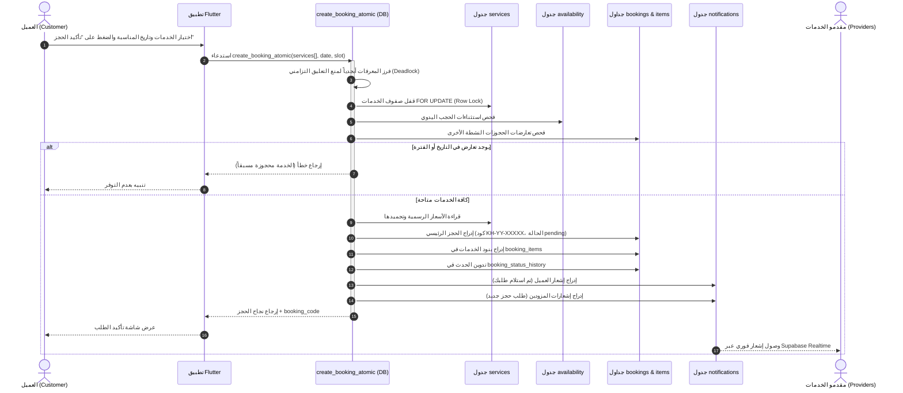
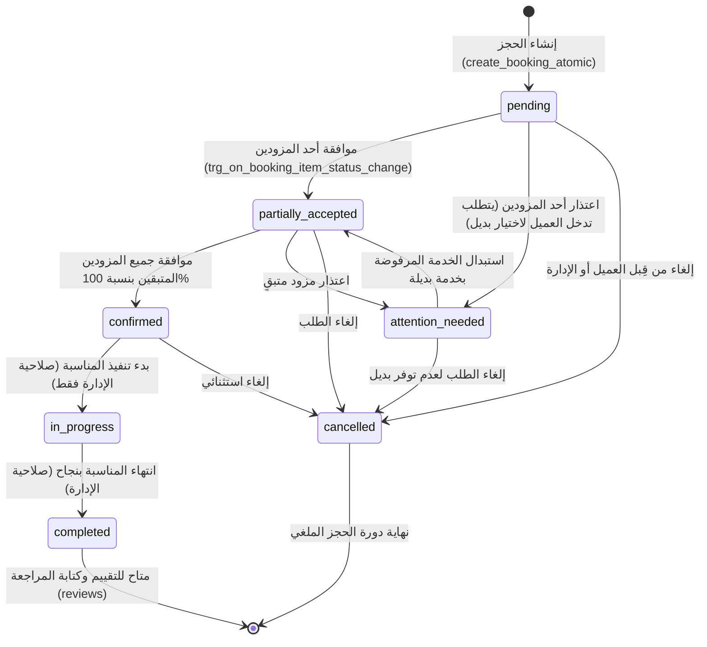

# مخطط الكيانات والعلاقات (Entity Relationship Diagram - ERD)
**التوثيق الهندسي للعلاقات الفعلية وسلوكيات المفاتيح الخارجية في قاعدة بيانات خِدمتي (Khadematy)**

---

## 1. مخطط الكيانات والعلاقات الشامل (Mermaid ERD)

المخطط التالي يعكس البنية المعتمدة والمنفذة فعلياً على خادم Supabase، موضحاً المفاتيح الأساسية (PK)، المفاتيح الأجنبية (FK)، والقيود الفريدة (UK)، مع دقة العلاقات وسلوكيات الحذف:

```mermaid
erDiagram
    %% Core Authentication & User
    AUTH_USERS ||--o| PROFILES : "يمتلك حساب مستخدم (1:1)"
    PROFILES ||--o| PROVIDER_PROFILES : "يمتلك ملف مزود معتمد (1:1)"
    PROFILES ||--o{ PROVIDER_APPLICATIONS : "يقدم طلبات انضمام (1:N)"
    PROFILES ||--o{ PACKAGES : "يطلب باقات ذكية (1:N)"
    PROFILES ||--o{ BOOKINGS : "يجري حجوزات (1:N)"
    PROFILES ||--o{ FAVORITES : "يضيف لمفضلته (1:N)"
    PROFILES ||--o{ REVIEWS : "يكتب تقييمات (1:N)"
    PROFILES ||--o{ COMPLAINTS : "يقدم شكاوى (1:N)"
    PROFILES ||--o{ NOTIFICATIONS : "يستلم إشعارات (1:N)"
    PROFILES ||--o{ BOOKING_STATUS_HISTORY : "ينفذ تعديلات على الحالة (1:N)"

    %% Categories & Services
    CATEGORIES ||--o{ SERVICES : "تصنف الخدمات (1:N)"
    PROVIDER_PROFILES ||--o{ SERVICES : "يقدم خدمات (1:N)"
    SERVICES ||--o{ SERVICE_IMAGES : "تحتوي صوراً متعددة (1:N)"
    SERVICES ||--o{ SERVICE_AVAILABILITY : "تحدد استثناءات التوفر (1:N)"
    SERVICES ||--o{ FAVORITES : "تُضاف للمفضلة (1:N)"
    SERVICES ||--o{ REVIEWS : "تتلقى تقييمات (1:N)"

    %% Smart Packaging
    PACKAGES ||--o{ PACKAGE_ITEMS : "تتكون من بنود خدمات (1:N)"
    SERVICES ||--o{ PACKAGE_ITEMS : "تدخل كخدمة مقترحة (1:N)"
    PACKAGES ||--o{ BOOKINGS : "تُحول إلى حجز فعلي (0..1:N)"

    %% Bookings & Operations
    BOOKINGS ||--o{ BOOKING_ITEMS : "يتكون من بنود محجوزة (1:N)"
    SERVICES ||--o{ BOOKING_ITEMS : "تُحجز كبند فعلي (1:N)"
    BOOKINGS ||--o{ BOOKING_STATUS_HISTORY : "يحتفظ بسجل تاريخ الحالات (1:N)"
    BOOKINGS ||--o{ REVIEWS : "يرتبط بتقييم بعد التنفيذ (0..1:N)"
    BOOKINGS ||--o{ COMPLAINTS : "يرتبط بشكوى إن وُجد نزاع (0..1:N)"
    BOOKINGS ||--o{ NOTIFICATIONS : "يولد إشعارات مرتبطة (0..1:N)"

    AUTH_USERS {
        uuid id PK
        string email
    }

    PROFILES {
        uuid id PK,FK "auth.users(id) ON DELETE CASCADE"
        string full_name
        string email
        string phone
        string avatar_url
        string role "CHECK customer, provider, admin"
        boolean is_active "DEFAULT true"
        timestamp created_at
        timestamp updated_at
    }

    PROVIDER_PROFILES {
        uuid id PK
        uuid user_id FK,UK "profiles(id) ON DELETE CASCADE"
        string business_name
        string description
        string logo_url
        string address
        string status "CHECK pending, approved, rejected, suspended"
        string category "حقل حي إضافي"
        timestamp approved_at
        timestamp created_at
        timestamp updated_at
    }

    PROVIDER_APPLICATIONS {
        uuid id PK
        uuid user_id FK "profiles(id) ON DELETE CASCADE"
        string business_name
        string description
        string phone
        string address
        string status "CHECK pending, approved, rejected"
        uuid reviewed_by FK "profiles(id) ON DELETE SET NULL"
        timestamp reviewed_at
        string rejection_reason
        timestamp created_at
        timestamp updated_at
    }

    CATEGORIES {
        uuid id PK
        string name
        string description
        string image_url
        boolean is_active "DEFAULT true"
        integer sort_order "DEFAULT 0"
        timestamp created_at
        timestamp updated_at
    }

    SERVICES {
        uuid id PK
        uuid provider_id FK "provider_profiles(id) ON DELETE RESTRICT"
        uuid category_id FK "categories(id) ON DELETE RESTRICT"
        string name
        string description
        numeric price "CHECK price >= 0"
        string currency "DEFAULT YER"
        string image_url
        string location
        integer capacity "CHECK capacity > 0"
        array features "TEXT[]"
        string status "CHECK active, inactive, pending"
        timestamp created_at
        timestamp updated_at
    }

    SERVICE_IMAGES {
        uuid id PK
        uuid service_id FK "services(id) ON DELETE CASCADE"
        string image_url
        integer sort_order "DEFAULT 0"
        timestamp created_at
    }

    SERVICE_AVAILABILITY {
        uuid id PK
        uuid service_id FK "services(id) ON DELETE CASCADE"
        date available_date
        string time_slot "CHECK morning, evening, full_day"
        time start_time
        time end_time
        boolean is_available "DEFAULT true"
        timestamp created_at
    }

    PACKAGES {
        uuid id PK
        uuid customer_id FK "profiles(id) ON DELETE CASCADE"
        string name
        string event_type
        numeric budget "CHECK budget >= 0"
        integer guest_count "CHECK guest_count > 0"
        numeric estimated_total "CHECK estimated_total >= 0"
        string currency "DEFAULT YER"
        string status "CHECK suggested, selected, expired"
        string generation_method "DEFAULT automatic"
        timestamp created_at
        timestamp updated_at
    }

    PACKAGE_ITEMS {
        uuid id PK
        uuid package_id FK "packages(id) ON DELETE CASCADE"
        uuid service_id FK "services(id) ON DELETE RESTRICT"
        integer quantity "DEFAULT 1, CHECK > 0"
        numeric unit_price "CHECK unit_price >= 0"
        numeric subtotal "CHECK subtotal >= 0"
        timestamp created_at
    }

    BOOKINGS {
        uuid id PK
        string booking_code UK "توليد KH-YY-XXXXX"
        uuid customer_id FK "profiles(id) ON DELETE RESTRICT"
        uuid package_id FK "packages(id) ON DELETE SET NULL"
        string event_type
        date event_date
        string time_slot "CHECK morning, evening, full_day"
        string event_location
        integer guest_count "CHECK guest_count > 0"
        numeric budget
        numeric total_amount "CHECK total_amount >= 0"
        string status "pending, confirmed, cancelled..."
        string notes
        timestamp created_at
        timestamp updated_at
    }

    BOOKING_ITEMS {
        uuid id PK
        uuid booking_id FK "bookings(id) ON DELETE CASCADE"
        uuid service_id FK "services(id) ON DELETE RESTRICT"
        integer quantity "DEFAULT 1, CHECK > 0"
        numeric unit_price "تجميد السعر الرسمي"
        numeric subtotal
        string item_status "pending, accepted, rejected"
        string rejection_reason
        timestamp responded_at
        timestamp created_at
    }

    FAVORITES {
        uuid id PK
        uuid user_id FK "profiles(id) ON DELETE CASCADE"
        uuid service_id FK "services(id) ON DELETE CASCADE"
        timestamp created_at
    }

    REVIEWS {
        uuid id PK
        uuid customer_id FK "profiles(id) ON DELETE CASCADE"
        uuid service_id FK "services(id) ON DELETE CASCADE"
        uuid booking_id FK "bookings(id) ON DELETE SET NULL"
        smallint rating "CHECK 1 to 5"
        string comment
        string provider_reply "حقل حي إضافي"
        timestamp created_at
        timestamp updated_at
    }

    COMPLAINTS {
        uuid id PK
        uuid user_id FK "profiles(id) ON DELETE CASCADE"
        uuid booking_id FK "bookings(id) ON DELETE SET NULL"
        string subject
        string description
        string status "pending, in_review, resolved, closed"
        uuid assigned_to FK "profiles(id) ON DELETE SET NULL"
        string resolution
        timestamp created_at
        timestamp updated_at
    }

    NOTIFICATIONS {
        uuid id PK
        uuid user_id FK "profiles(id) ON DELETE CASCADE"
        string title
        string body
        string type
        uuid related_booking_id FK "bookings(id) ON DELETE SET NULL"
        boolean is_read "DEFAULT false"
        timestamp created_at
    }

    BOOKING_STATUS_HISTORY {
        uuid id PK
        uuid booking_id FK "bookings(id) ON DELETE CASCADE"
        string old_status
        string new_status
        uuid changed_by FK "profiles(id) ON DELETE SET NULL"
        string note
        timestamp created_at
    }
```

---

## 2. مصفوفة العلاقات والقيود الأجنبية (Foreign Keys Matrix)

توضح المصفوفة التالية جميع المفاتيح الخارجية في قاعدة البيانات، مع نوع العلاقة، وسلوك الحذف (`ON DELETE Action`)، والتعليل الفني والمالي لاختيار هذا السلوك:

| الجدول المصدر (Source) | الحقل المصدر (FK) | الجدول الهدف (Target) | الحقل الهدف (PK) | نوع العلاقة | إجراء الحذف (ON DELETE) | التعليل الفني والتجاري |
|---|---|---|---|---|---|---|
| `profiles` | `id` | `auth.users` | `id` | `1 : 1` | `CASCADE` | حذف الحساب من نظام المصادقة يستوجب إزالة الملف الشخصي المرتبط تلقائياً لضمان التزامن. |
| `provider_profiles` | `user_id` | `profiles` | `id` | `1 : 1` (فريدة) | `CASCADE` | حذف المستخدم يزيل ملف المزود المهني المرتبط به. |
| `provider_applications` | `user_id` | `profiles` | `id` | `1 : N` | `CASCADE` | طلبات الانضمام تابعة لحساب المستخدم؛ تُحذف بحذف حسابه. |
| `provider_applications` | `reviewed_by` | `profiles` | `id` | `N : 1` (اختيارية) | `SET NULL` | إذا تم حذف حساب المشرف أو المراجع، تبقى طلبات الانضمام السابقة محفوظة مع إفراغ معرّف المراجع. |
| `services` | `provider_id` | `provider_profiles` | `id` | `N : 1` | **`RESTRICT`** | **حماية استراتيجية:** يمنع حذف أي مزود خدمة إذا كان لديه خدمات مسجلة ومرتبطة بحجوزات سابقة منعاً لفساد البيانات التاريخية والمالية. |
| `services` | `category_id` | `categories` | `id` | `N : 1` | **`RESTRICT`** | يمنع حذف أي تصنيف إذا كانت ترتبط به خدمات نشطة. |
| `service_images` | `service_id` | `services` | `id` | `1 : N` | `CASCADE` | صور الخدمة تابعة كلياً للخدمة؛ وتُحذف معها تلقائياً. |
| `service_availability` | `service_id` | `services` | `id` | `1 : N` | `CASCADE` | جدول الحجب والتوفر يتبع الخدمة وتنتفي فائدته بحذفها. |
| `packages` | `customer_id` | `profiles` | `id` | `N : 1` (اختيارية) | `CASCADE` | الباقات المقترحة للعميل تحذف عند حذف حسابه. |
| `package_items` | `package_id` | `packages` | `id` | `1 : N` | `CASCADE` | بنود الباقة مرتبطة كلياً بوجود الباقة؛ وتُحذف متتالياً معها. |
| `package_items` | `service_id` | `services` | `id` | `N : 1` | **`RESTRICT`** | يمنع حذف أي خدمة مسجلة داخل باقة مقترحة نشطة. |
| `bookings` | `customer_id` | `profiles` | `id` | `N : 1` | **`RESTRICT`** | **حماية مالية وقانونية صارمة:** يمنع حذف أي حساب عميل إذا كان لديه سجل حجوزات مالية تاريخية في المنصة؛ يجب أرشفة الحساب بدلاً من حذفه. |
| `bookings` | `package_id` | `packages` | `id` | `N : 1` (اختيارية) | `SET NULL` | الحجز كيان مالي مستقل؛ إذا حُذفت الباقة المقترحة لاحقاً، يبقى سجل الحجز وعناصره قائماً دون تأثر وتصبح `package_id = NULL`. |
| `booking_items` | `booking_id` | `bookings` | `id` | `1 : N` | `CASCADE` | عناصر الحجز جزء لا يتجزأ من طلب الحجز؛ وتُحذف إذا حُذف الحجز الأم. |
| `booking_items` | `service_id` | `services` | `id` | `N : 1` | **`RESTRICT`** | **قيد مالي:** يمنع مسح أي خدمة من قاعدة البيانات طالما تم طلبها في حجز (حتى لو كان ملغياً)، حفاظاً على كشوف الحسابات. |
| `favorites` | `user_id` | `profiles` | `id` | `N : 1` | `CASCADE` | حذف المستخدم يزيل قائمته المفضلة. |
| `favorites` | `service_id` | `services` | `id` | `N : 1` | `CASCADE` | حذف الخدمة يزيلها من قوائم المفضلة تلقائياً. |
| `reviews` | `customer_id` | `profiles` | `id` | `N : 1` | `CASCADE` | تقييمات المستخدم تُحذف مع حسابه. |
| `reviews` | `service_id` | `services` | `id` | `N : 1` | `CASCADE` | حذف الخدمة يزيل مراجعاتها. |
| `reviews` | `booking_id` | `bookings` | `id` | `N : 1` (اختيارية) | `SET NULL` | إذا حُذف الحجز المرجعي، يبقى التقييم العام للخدمة محفوظاً. |
| `complaints` | `user_id` | `profiles` | `id` | `N : 1` | `CASCADE` | شكاوى المستخدم تُحذف مع حسابه. |
| `complaints` | `booking_id` | `bookings` | `id` | `N : 1` (اختيارية) | `SET NULL` | الشكوى تبقى مقيدة في النظام حتى لو أُزيل الحجز. |
| `complaints` | `assigned_to` | `profiles` | `id` | `N : 1` (اختيارية) | `SET NULL` | إذا حُذف حساب موظف الدعم المكلف، تعود الشكوى لغير مسندة (`NULL`). |
| `notifications` | `user_id` | `profiles` | `id` | `N : 1` | `CASCADE` | إشعارات المستخدم تُحذف عند حذف حسابه. |
| `notifications` | `related_booking_id` | `bookings` | `id` | `N : 1` (اختيارية) | `SET NULL` | الإشعار يبقى مقروءاً ومحفوظاً حتى لو أُزيل الحجز التابع له. |
| `booking_status_history` | `booking_id` | `bookings` | `id` | `1 : N` | `CASCADE` | سجل تدقيق الحالات يتبع الحجز الأم؛ ويُحذف معه. |
| `booking_status_history` | `changed_by` | `profiles` | `id` | `N : 1` (اختيارية) | `SET NULL` | إذا حُذف حساب من غيّر الحالة، يبقى السجل التاريخي موثقاً. |

---

## 3. مخططات تدفق العمليات والتسلسل (Sequence Diagrams)

### 3.1 تدفق الحجز الذري وتوزيع الإشعارات (`create_booking_atomic`)
المخطط التسلسلي التالي يوضح تسلسل الخطوات المتزامن عند استدعاء العميل لدالة الحجز الذري:

---

### 3.2 دورة حياة الحجز وانتقال الحالات (Booking State Machine)
المخطط التالي يوضح القيود والمشغلات المتحكمة في انتقال حالات الحجز في المنصة:

